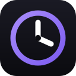
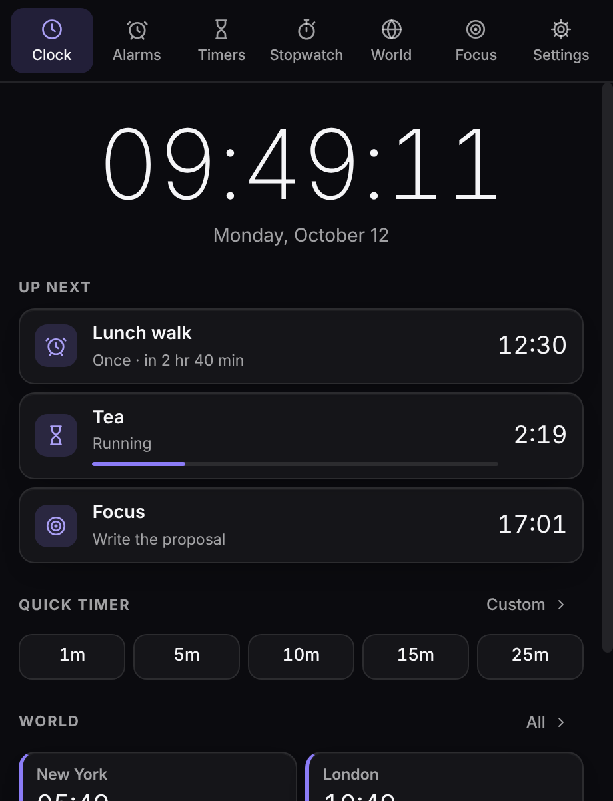
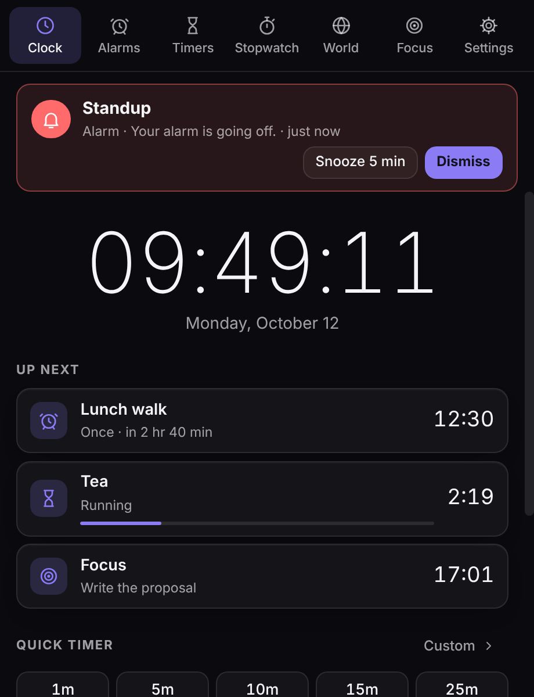
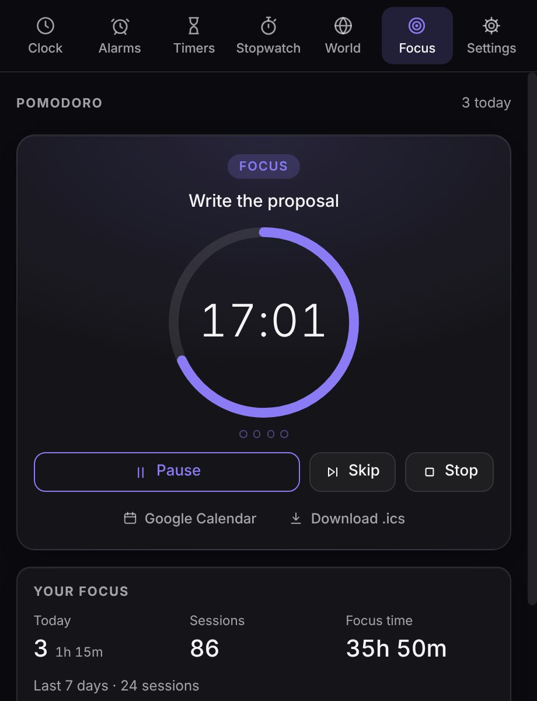
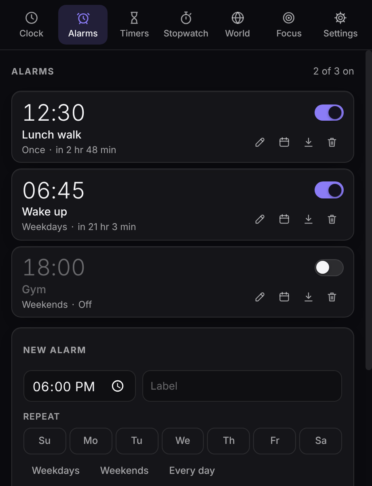
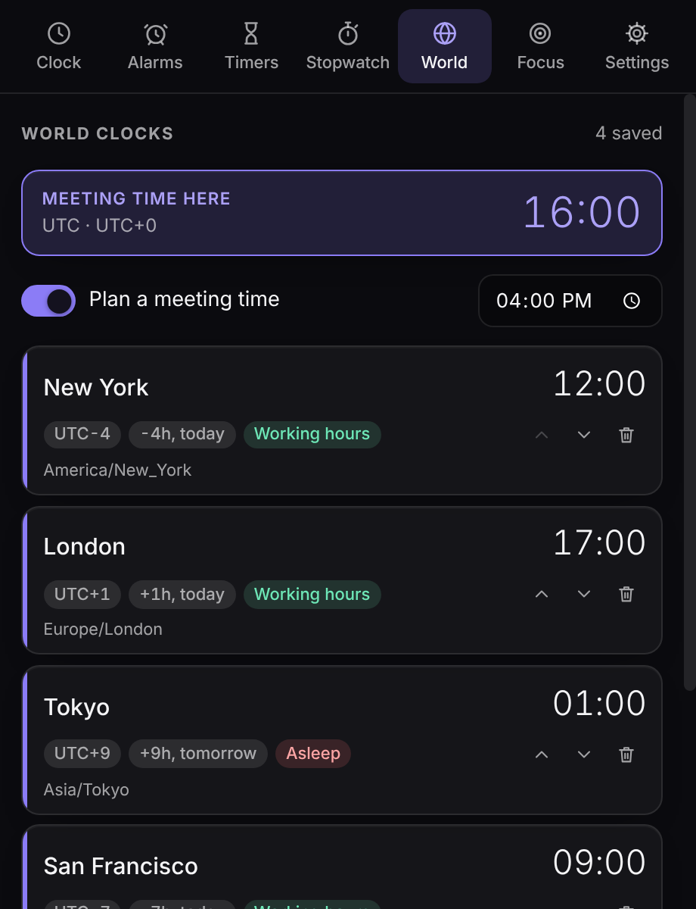
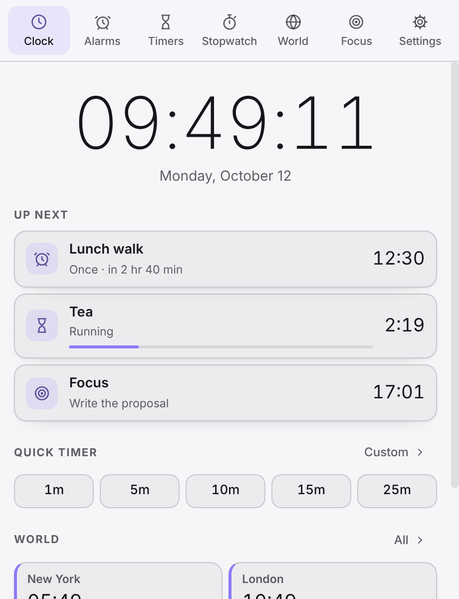

<div align="center">



# Chronly

**A calm, private clock, alarm, and focus workspace for your browser toolbar.**

Alarms, timers, a stopwatch, world clocks, and Pomodoro sessions that keep
working when the popup closes, in Chrome and Firefox. No account, no tracking,
no server.

[](https://github.com/fredrikblau/chronly/actions/workflows/ci.yml)
[](LICENSE)
[](#install)
[](#install)
[](docs/PRIVACY.md)
[](CONTRIBUTING.md)





<details>
<summary>More screenshots</summary>
<br>



</details>

</div>

## Why Chronly

Browser timers tend to fail quietly: the popup closes, the background worker
is suspended, the laptop sleeps, and the alarm never rings. Chronly is built
around not letting that happen.

- **It rings.** Every alarm, timer, and Pomodoro phase is stored as an absolute
  time and scheduled with the browser's own alarm API, so it survives a closed
  popup, a suspended service worker, a browser restart, and sleep.
- **You can always stop it.** Sound and a system notification fire together.
  If the notification is hidden or blocked, the toolbar icon shows a badge and
  the popup shows Snooze and Dismiss, which matters on Firefox, where
  notifications have no buttons. On Firefox, click the notification or press
  Dismiss in the popup to stop it.
- **It stays yours.** No account, analytics, ads, remote code, or host
  permissions. Everything is stored in your browser, and you can export it to a
  file.
- **It's for everyone.** Keyboard shortcuts, screen-reader labels, reduced
  motion, adjustable text size, and an automated WCAG 2.1 AA audit of every
  tab in both themes.
- **It's open.** MIT licensed, with around 400 unit tests and an end-to-end
  suite that drives the real extension in Chromium.

## Features

| Feature          | What you get                                                                                                                                                                                                         |
| ---------------- | -------------------------------------------------------------------------------------------------------------------------------------------------------------------------------------------------------------------- |
| **Overview**     | The time, what rings next, live timers, your focus session, one-click quick timers, and a glance at world clocks.                                                                                                    |
| **Alarms**       | One-off or repeating on chosen days, an on/off switch, in-place editing, snooze, a Test button, and calendar export (Google Calendar or `.ics`).                                                                     |
| **Timers**       | As many countdowns as you like, with an hours field, pause and resume, +1 minute, and restart.                                                                                                                       |
| **Stopwatch**    | Lap splits, with the fastest and slowest lap highlighted. Keeps running with the popup closed.                                                                                                                       |
| **World clocks** | Type a city the way you write it ("new york", "São Paulo", "San Francisco"), and see offsets, day differences, and whether people there are at work or asleep. Meeting-planner mode checks a time across every zone. |
| **Focus**        | Pomodoro cycles that advance in the background, with Skip, presets, today's count, and a 7-day chart.                                                                                                                |
| **Sounds**       | Eight bundled CC0 tones, or import your own MP3, WAV, OGG, M4A, AAC, FLAC, or WebM file.                                                                                                                             |
| **Appearance**   | Light, dark, or automatic themes; digital, analog, or both clock faces; gradients and accent colours; text size; reduced motion.                                                                                     |
| **Backup**       | Export alarms, world clocks, and appearance to a JSON file and import them on another browser.                                                                                                                       |

### Keyboard

| Key                       | Action                       |
| ------------------------- | ---------------------------- |
| <kbd>1</kbd>–<kbd>7</kbd> | Switch tab                   |
| <kbd>←</kbd> <kbd>→</kbd> | Move between tabs            |
| <kbd>Space</kbd>          | Start or pause the stopwatch |
| <kbd>L</kbd>              | Record a stopwatch lap       |

## Install

**From a store:** Chrome Web Store and Firefox Add-ons listings are on the way.

**Try a release build:** each [GitHub release](https://github.com/fredrikblau/chronly/releases)
includes a Chrome build to load unpacked and a Firefox build to load temporarily.

**From source** (about two minutes):

```bash
git clone https://github.com/fredrikblau/chronly.git
cd chronly
npm install
npm run build            # or: npm run build:firefox
```

- **Chrome:** open `chrome://extensions`, turn on Developer mode, choose
  **Load unpacked**, and select `.output/chrome-mv3/`.
- **Firefox:** open `about:debugging#/runtime/this-firefox`, choose
  **Load Temporary Add-on**, and select any file in `.output/firefox-mv3/`.

## Privacy and permissions

Chronly asks only for what it needs. This is the entire `permissions` list in
the built manifest:

| Permission                | Why                                                                                                                         |
| ------------------------- | --------------------------------------------------------------------------------------------------------------------------- |
| `alarms`                  | Wakes the background so alarms, timers, and Pomodoro phases fire after the browser has suspended it.                        |
| `notifications`           | Shows the system notification when something rings.                                                                         |
| `storage`                 | Keeps your alarms, timers, settings, stats, and imported sounds in the browser.                                             |
| `offscreen` (Chrome only) | Lets Chrome play sound, because its background service worker has no audio API. Firefox's background page does not need it. |

There are no `host_permissions`. Sounds are bundled, so nothing is downloaded
when an alarm rings. See the [privacy policy](docs/PRIVACY.md) for details.

## Contributing

Contributions of every size are welcome: bug reports, testing in a browser you
use, docs, a city alias, an icon, or a feature. Start with
[CONTRIBUTING.md](CONTRIBUTING.md); it has the setup, the test commands, and
recipes for common changes.

```bash
npm install
npm run dev              # Chrome with hot reload (npm run dev:firefox for Firefox)
npm run preview:popup    # the popup in a normal browser tab, no extension needed
npm run check            # typecheck, lint, format check, and unit tests
```

Good places to start:

- Issues labelled [`good first issue`](https://github.com/fredrikblau/chronly/issues?q=is%3Aissue+is%3Aopen+label%3A%22good+first+issue%22).
- Add a city to [`lib/core/cityAliases.ts`](lib/core/cityAliases.ts) that you
  coordinate with but can't find.
- Test a [release build](https://github.com/fredrikblau/chronly/releases) on
  your OS and browser and report what you find.

To learn how the code fits together, see [docs/ARCHITECTURE.md](docs/ARCHITECTURE.md).

## Project layout

```
entrypoints/   background worker, popup, and Chrome's offscreen audio page
lib/core/      framework-free logic: scheduling, storage, time zones, alerts, backup
lib/ui/        thin Svelte stores and display formatting over lib/core
components/    the popup's panels and shared pieces (Icon, RingingBanner, ...)
e2e/           Playwright specs that drive the built extension in Chromium
tests/         Vitest suites for the popup shell and background worker
harness/       standalone Vite preview of the popup
scripts/       manifest checks and screenshot and store-asset generators
```

## Firefox source review build

AMO reviewers can use Mozilla's default Ubuntu 24.04 environment with Node
24.14.0 and npm 11.9.0. From the source archive root:

```bash
npm ci
npm run build:firefox
```

The reviewable extension is written to `.output/firefox-mv3/`. The build uses
the open-source packages pinned in `package-lock.json` and needs no network
access after `npm ci`. Release steps are in [RELEASING.md](RELEASING.md); store
copy and assets are in [docs/STORE_LISTING.md](docs/STORE_LISTING.md).

## License

[MIT](LICENSE). Bundled sounds are CC0; see [docs/ASSET_LICENSES.md](docs/ASSET_LICENSES.md).

If Chronly saves you from a missed alarm, a ⭐ helps other people find it.
