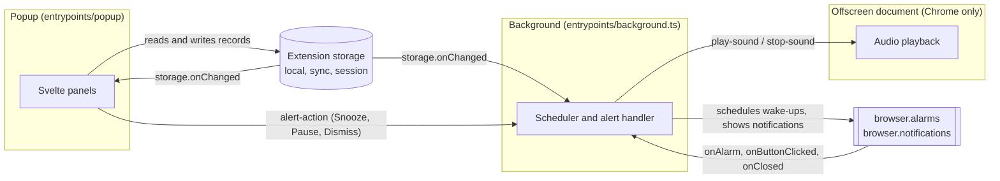
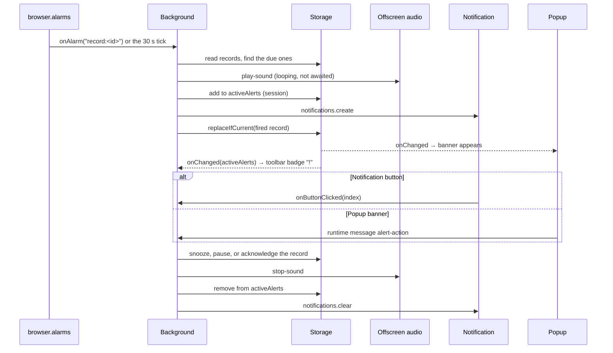

# How Chronly works

Chronly is small, but it runs in three or four separate browser contexts that
can each disappear at any moment. This page explains how they cooperate so you
can change one without breaking the others.

## The contexts

- **Popup.** Created every time the toolbar button is clicked and destroyed when
  it closes. It never owns time; it renders from storage and writes changes back.
- **Background.** A Manifest V3 service worker on Chrome and an event page on
  Firefox. The browser suspends it whenever it is idle, so it holds no state in
  memory that matters. Every listener is registered synchronously at start-up
  so a wake-up event is never missed.
- **Offscreen document.** Chrome's service worker has no audio API, so Chrome
  plays alarm sounds from a hidden page. Firefox plays them from its background
  page instead.
- **Storage** is the single source of truth. The popup and the background never
  need each other to be awake.

## Rules that keep it reliable

1. **Store absolute times, never counters.** A timer is a `targetTimestamp`; a
   paused one banks `remainingMsAtPause`. Anything can be torn down and rebuilt
   from storage without drifting.
2. **Two ways to wake up.** Each scheduled record gets its own `browser.alarms`
   entry (`record:<id>`) for precision, and a 30-second `tick` alarm reconciles
   everything as a safety net after sleep or a dropped alarm.
3. **Firing is idempotent.** `reconcileDueRecords` marks a record `notified` (or
   advances it) with `replaceIfCurrent`, which refuses to write if the popup
   changed the record in the meantime. A late tick never replays an alert.
4. **Concurrent writes are serialised.** The popup and background write the same
   keys from different realms, so read-modify-write sections run under a
   [Web Lock](https://developer.mozilla.org/docs/Web/API/Web_Locks_API) shared
   through the extension origin (`withLock` in `lib/core/storage.ts`).
5. **Sound and notification are independent.** The background starts the sound
   without awaiting it and shows the notification separately, so one failing
   channel never silences the other.

## What happens when an alarm rings

Both paths end in `handleAlertAction`, so the banner and the notification
buttons can never disagree. The popup sends a message rather than acting
itself because on Firefox the sound plays inside the background page, which
only the background can stop.

## Storage keys

| Key             | Area    | Written by        | Holds                                                      |
| --------------- | ------- | ----------------- | ---------------------------------------------------------- |
| `records`       | local   | popup, background | Alarms, timers, and the Pomodoro session, keyed by id      |
| `stopwatch`     | local   | popup             | The one stopwatch (not scheduled, so not a record)         |
| `pomodoroStats` | local   | background        | All-time totals and the last month of daily focus counts   |
| `customSounds`  | local   | popup             | Imported audio as data URLs                                |
| `activeAlerts`  | session | background        | What is ringing right now; cleared when the browser closes |
| `settings`      | sync    | popup             | Appearance and clock preferences                           |
| `worldClocks`   | sync    | popup             | Saved zones, labels, colours, order                        |

The popup also remembers its last tab in `localStorage`; that is a per-device
convenience and nothing depends on it.

## Where the code lives

| Path                          | What it is                                                                                    |
| ----------------------------- | --------------------------------------------------------------------------------------------- |
| `lib/core/types.ts`           | Every stored shape. Start here.                                                               |
| `lib/core/scheduler.ts`       | Pure functions: create, snooze, pause, skip, re-arm, and what a record becomes once it fires. |
| `lib/core/storage.ts`         | Typed stores over extension storage, with locking.                                            |
| `lib/core/notifications.ts`   | Notification content and the alert actions each kind offers.                                  |
| `lib/core/time.ts`            | Time-zone maths and turning typed city names into zones.                                      |
| `lib/core/backup.ts`          | Backup export, validation, and merge-on-import.                                               |
| `entrypoints/background.ts`   | Wires browser events to the core functions above.                                             |
| `lib/ui/`                     | Svelte stores that mirror storage, plus display formatting.                                   |
| `components/`                 | One component per panel, plus `Icon`, `RingingBanner`, and `SoundPicker`.                     |
| `entrypoints/popup/theme.css` | Colour tokens and shared primitives (`.btn`, `.input`, `.switch`, `.card`).                   |

`lib/core` has no UI code and no Svelte, which keeps the logic that decides
when things ring easy to test in isolation.

## Testing layers

| Layer                | Tool                                      | Where                            |
| -------------------- | ----------------------------------------- | -------------------------------- |
| Core logic           | Vitest                                    | `lib/**/*.test.ts`               |
| Panels and the popup | Vitest, Testing Library, jsdom            | `components/*.test.ts`, `tests/` |
| Background wiring    | Vitest with `@webext-core/fake-browser`   | `tests/background.test.ts`       |
| The real extension   | Playwright driving a built Chromium build | `e2e/*.spec.ts`                  |

The end-to-end suite seeds records a few seconds in the future to watch the
background worker fire them, and checks notifications, the badge, and
`browser.alarms` directly through the extension APIs.
